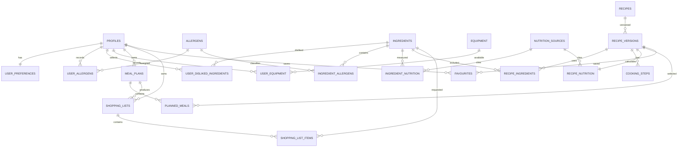

# MealMate India MVP Database Design

PostgreSQL is the system of record for authenticated user data, verified food data, meal plans, favourites, and shopping lists. Supabase Auth owns login identity; application tables reference its user UUID. Allergy filtering is enforced in backend queries and meal-plan generation, not by database constraints alone.

## Conventions and domain values

- Primary keys use `uuid`; timestamps use `timestamptz`; money uses `numeric(10,2)`; quantities use `numeric(10,3)`.
- Use PostgreSQL enums or checked values for `preference` (`vegetarian`, `egg`, `non_vegetarian`), `skill_level`, `plan_type` (`daily`, `weekly`), and meal slots (`breakfast`, `morning_snack`, `lunch`, `evening_snack`, `dinner`).
- `raw` and `cooked` are explicit ingredient states. Nutrition rows are nullable: missing nutrition is unknown, never zero.
- Recipe content is immutable by version. A recipe points to a current version, while plans and favourites reference the exact version used.

## Tables

### `profiles`

| Column | Type | Key / constraints |
|---|---|---|
| `user_id` | `uuid` | PK, FK → `auth.users.id`, `ON DELETE CASCADE` |
| `display_name` | `text` | nullable, length checked |
| `created_at` | `timestamptz` | NOT NULL, default `now()` |
| `updated_at` | `timestamptz` | NOT NULL, default `now()` |

One profile belongs to one Supabase user. Index `created_at` only if operational reporting is needed.

### `user_preferences`

| Column | Type | Key / constraints |
|---|---|---|
| `user_id` | `uuid` | PK, FK → `profiles.user_id`, `ON DELETE CASCADE` |
| `food_preference` | `text` | NOT NULL, checked enum values |
| `daily_budget_inr` | `numeric(10,2)` | NOT NULL, `>= 0` |
| `skill_level` | `text` | NOT NULL, checked values |
| `available_minutes` | `smallint` | NOT NULL, `> 0` |
| `preferred_cuisine` | `text` | NOT NULL; MVP value includes `south_indian` |
| `created_at` / `updated_at` | `timestamptz` | NOT NULL |

One-to-one with `profiles`. Index `preferred_cuisine` and `food_preference` for candidate filtering.

### `allergens`, `user_allergens`, `user_disliked_ingredients`

`allergens` contains `id uuid PK`, `name text NOT NULL UNIQUE`, and `created_at timestamptz NOT NULL`.

`user_allergens` contains `user_id uuid FK → profiles`, `allergen_id uuid FK → allergens`, and `created_at timestamptz`; primary key is (`user_id`, `allergen_id`).

`user_disliked_ingredients` contains `user_id uuid FK → profiles`, `ingredient_id uuid FK → ingredients`, and `created_at timestamptz`; primary key is (`user_id`, `ingredient_id`).

All foreign keys use `ON DELETE CASCADE`. Index each lookup by its second key (`allergen_id`, `ingredient_id`). These rows are exclusion inputs for backend planning.

### `equipment` and `user_equipment`

`equipment` contains `id uuid PK`, `name text NOT NULL UNIQUE`, and `is_active boolean NOT NULL DEFAULT true`.

`user_equipment` contains `user_id uuid FK → profiles`, `equipment_id uuid FK → equipment`, and `created_at timestamptz`; primary key is (`user_id`, `equipment_id`). Index `equipment_id`.

### `ingredients`

| Column | Type | Key / constraints |
|---|---|---|
| `id` | `uuid` | PK |
| `canonical_name` | `text` | NOT NULL |
| `state` | `text` | NOT NULL, `raw` or `cooked` |
| `default_unit` | `text` | NOT NULL |
| `is_active` | `boolean` | NOT NULL, default `true` |
| `created_at` / `updated_at` | `timestamptz` | NOT NULL |

Unique (`canonical_name`, `state`). Index `canonical_name`; index active ingredients used for search. Raw and cooked variants must not be silently substituted.

### `ingredient_allergens`

Contains `ingredient_id uuid FK → ingredients`, `allergen_id uuid FK → allergens`, and `source_note text NOT NULL`; primary key is (`ingredient_id`, `allergen_id`). Index `allergen_id` for exclusion queries. Direct and documented source data is required for published allergen mappings.

### `nutrition_sources`

| Column | Type | Key / constraints |
|---|---|---|
| `id` | `uuid` | PK |
| `publisher` | `text` | NOT NULL |
| `reference` | `text` | NOT NULL |
| `retrieved_at` | `timestamptz` | NOT NULL |
| `notes` | `text` | nullable |

Unique (`publisher`, `reference`). A source is required for every published nutrition row.

### `ingredient_nutrition`

| Column | Type | Key / constraints |
|---|---|---|
| `id` | `uuid` | PK |
| `ingredient_id` | `uuid` | NOT NULL, FK → `ingredients` |
| `nutrition_source_id` | `uuid` | NOT NULL, FK → `nutrition_sources` |
| `serving_quantity` | `numeric(10,3)` | NOT NULL, `> 0` |
| `serving_unit` | `text` | NOT NULL |
| `calories_kcal` | `numeric(10,3)` | nullable, `>= 0` |
| `protein_g` / `carbohydrate_g` / `fat_g` | `numeric(10,3)` | nullable, `>= 0` |
| `created_at` | `timestamptz` | NOT NULL |

Index (`ingredient_id`, `created_at DESC`). Nullable nutrient values remain unknown and must be propagated as unknown in calculations.

### `recipes` and `recipe_versions`

`recipes` contains `id uuid PK`, `slug text NOT NULL UNIQUE`, `title text NOT NULL`, `cuisine text NOT NULL`, `food_preference text NOT NULL`, `is_active boolean NOT NULL DEFAULT true`, `current_version_id uuid NULL`, and timestamps. `current_version_id` FK → `recipe_versions.id` is added after both tables exist.

`recipe_versions` contains `id uuid PK`, `recipe_id uuid NOT NULL FK → recipes ON DELETE RESTRICT`, `version_number integer NOT NULL`, `description text`, `preparation_minutes smallint NOT NULL CHECK >= 0`, `cooking_minutes smallint NOT NULL CHECK >= 0`, `servings smallint NOT NULL CHECK > 0`, `skill_level text NOT NULL`, `created_at timestamptz NOT NULL`, and `published_at timestamptz NULL`. Unique (`recipe_id`, `version_number`); index (`recipe_id`, `published_at DESC`).

The version stores recipe content that can change without rewriting historical plans. Publishing requires verified ingredients, allergen mappings, and nutrition metadata where available.

### `recipe_ingredients` and `cooking_steps`

`recipe_ingredients` contains `recipe_version_id uuid FK → recipe_versions`, `ingredient_id uuid FK → ingredients`, `quantity numeric(10,3) NOT NULL CHECK > 0`, `unit text NOT NULL`, `ingredient_state text NOT NULL` (`raw` or `cooked`), and `display_order smallint NOT NULL CHECK > 0`; primary key is (`recipe_version_id`, `display_order`). Index `ingredient_id`. The state must agree with the selected ingredient variant.

`cooking_steps` contains `recipe_version_id uuid FK → recipe_versions`, `step_number smallint CHECK > 0`, `instruction text NOT NULL`, and `duration_minutes smallint CHECK >= 0`; primary key is (`recipe_version_id`, `step_number`).

### `recipe_nutrition`

Contains `recipe_version_id uuid PK FK → recipe_versions`, `nutrition_source_id uuid NOT NULL FK → nutrition_sources`, `serving_size numeric(10,3) NOT NULL CHECK > 0`, `serving_unit text NOT NULL`, nullable `calories_kcal`, `protein_g`, `carbohydrate_g`, and `fat_g`, plus `calculation_note text NOT NULL` and `calculated_at timestamptz NOT NULL`.

Values are calculated per serving from verified ingredient data where possible. A NULL value means unavailable; no calculation may convert NULL to zero. Index `nutrition_source_id`.

### `meal_plans` and `planned_meals`

`meal_plans` contains `id uuid PK`, `user_id uuid NOT NULL FK → profiles ON DELETE CASCADE`, `plan_type text NOT NULL`, `start_date date NOT NULL`, `end_date date NOT NULL`, `budget_snapshot_inr numeric(10,2) NOT NULL CHECK >= 0`, `created_at timestamptz NOT NULL`, and `status text NOT NULL`. Check that `end_date >= start_date`; daily plans have equal dates and weekly plans cover at most seven dates. Index (`user_id`, `start_date DESC`).

`planned_meals` contains `id uuid PK`, `meal_plan_id uuid NOT NULL FK → meal_plans ON DELETE CASCADE`, `meal_date date NOT NULL`, `meal_slot text NOT NULL`, `recipe_version_id uuid NOT NULL FK → recipe_versions ON DELETE RESTRICT`, `servings numeric(10,2) NOT NULL CHECK > 0`, `status text NOT NULL`, and `created_at timestamptz NOT NULL`. Unique (`meal_plan_id`, `meal_date`, `meal_slot`); index (`meal_plan_id`, `meal_date`). Backend validation ensures dates fall inside the plan and recipes still satisfy the user’s restrictions.

### `shopping_lists` and `shopping_list_items`

`shopping_lists` contains `id uuid PK`, `user_id uuid NOT NULL FK → profiles ON DELETE CASCADE`, `meal_plan_id uuid NULL FK → meal_plans ON DELETE SET NULL`, `name text NOT NULL`, `created_at timestamptz NOT NULL`, and `updated_at timestamptz NOT NULL`. Index (`user_id`, `created_at DESC`).

`shopping_list_items` contains `id uuid PK`, `shopping_list_id uuid NOT NULL FK → shopping_lists ON DELETE CASCADE`, `ingredient_id uuid NOT NULL FK → ingredients ON DELETE RESTRICT`, `quantity numeric(10,3) NOT NULL CHECK > 0`, `unit text NOT NULL`, `ingredient_state text NOT NULL`, `is_checked boolean NOT NULL DEFAULT false`, and `created_at timestamptz NOT NULL`. Unique (`shopping_list_id`, `ingredient_id`, `unit`, `ingredient_state`); index `shopping_list_id`. Aggregation is performed by backend logic without combining incompatible units or raw/cooked states.

### `favourites`

Contains `user_id uuid NOT NULL FK → profiles ON DELETE CASCADE`, `recipe_version_id uuid NOT NULL FK → recipe_versions ON DELETE RESTRICT`, and `created_at timestamptz NOT NULL`; primary key is (`user_id`, `recipe_version_id`). Index `recipe_version_id`. This preserves the exact recipe version saved by the user.

## Relationships

## Backend enforcement notes

- Every recipe candidate must be checked against the user’s food preference, disliked ingredients, selected allergens, and equipment/time constraints before insertion into `planned_meals`.
- Row ownership checks are required for all profile-owned records, including plans, lists, list items, and favourites.
- Published recipe versions must not be deleted if referenced by a plan or favourite; deactivate or publish a replacement version instead.
- Nutrition APIs must expose NULL/unknown values distinctly from zero and include the relevant source reference and serving context.
